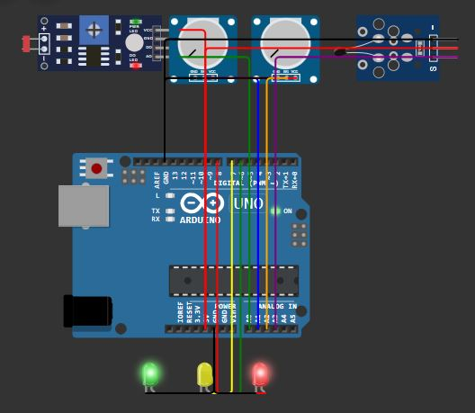
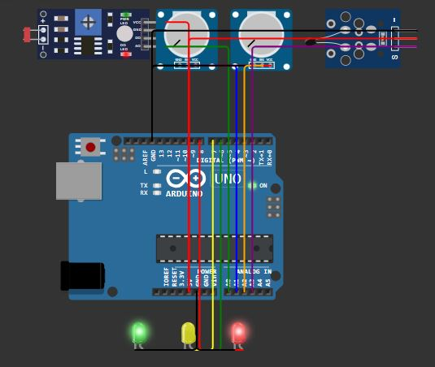

# ⚡ Edge-AI Smart Solar Microgrid & Autonomous Load Balancer

A hardware-in-the-loop (HIL) cyber-physical system combining embedded microcontroller telemetry with physics-informed machine learning for autonomous load shedding, thermal runaway prevention, and battery State-of-Health (SoH) forecasting.

## 🔗 Live Interactive Simulations
* **Hardware Circuit & Firmware (Wokwi):** [Launch Live Simulation](https://wokwi.com/projects/481758745417832449)
* **AI Models & Constrained Scheduler:** Open `microgrid_ai.ipynb` in this repository
* **Live AI Digital Twin Dashboard (Streamlit):** [Launch Interactive Web App](https://edge-ai-smart-solar-microgrid-autonomous-load-balancer-bewrkr6.streamlit.app/)

## 📊 System Architecture & Visual Validation

### 1. Hardware-in-the-Loop Circuit (`sketch.ino`, `diagram.json`)
Simulates an ATmega328P microcontroller reading solar irradiance, battery bus voltage, load current demand, and NTC thermal sensors to enforce deterministic hardware failsafes and priority load shedding (protecting critical clinic/water loads over non-critical residential loads).

### 2. Physics-Informed Machine Learning & Optimization (`microgrid_ai.ipynb`)
* **Grid State Classifier (Random Forest):** Predicts optimal balance, smart load shedding, active thermal cooling, and emergency brownout states.
* **Battery Degradation Predictor (Gradient Boosting + Arrhenius Kinetics):** Estimates electrochemical capacity fade under thermal and C-rate stress.
* **Constrained Priority Greedy Scheduler:** Allocates scarce solar generation across weighted community loads under strict State-of-Charge (SoC) reserve constraints.

